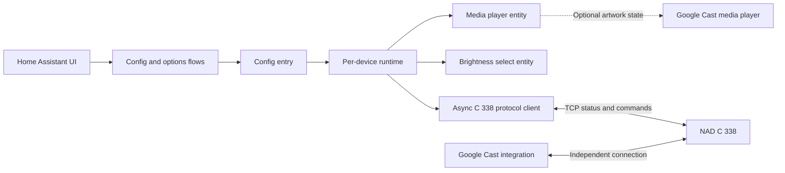

# System overview

## Status and scope

M3 implements UI setup, a TCP client, and a media player status entity. M4
controls passed 99 automated tests, lint, mypy, and supervised hardware
acceptance. Version `1.1.0` includes Chromecast cover art in the
[repository](https://github.com/DBlade82/NAD-C338-Ctrl). Marketplace
installation of beta.2 succeeded; update and HACS-specific installation
validation remain in M5.

The integration communicates directly with a NAD C 338 over the local
network. It coexists with, and does not replace or depend on, the Home Assistant
Google Cast integration.

## Components and data flow

| Component | Responsibility | Location |
| --- | --- | --- |
| Config and options flows | Validate host and model; configure maximum volume and step in the UI. | `custom_components/nad_c338/config_flow.py` |
| Integration lifecycle | Create and unload one runtime per config entry; cleanly close its tasks and connection. | `custom_components/nad_c338/__init__.py` |
| Protocol client | Own the asynchronous connection, message parsing, command serialization, reconnect, and device state. | `custom_components/nad_c338/client.py` |
| Media player entity | Expose power, source, volume, mute, availability, and device information to Home Assistant. | `custom_components/nad_c338/media_player.py` |
| Brightness select entity | Expose reported display brightness levels and send changes. | `custom_components/nad_c338/select.py` |
| UI text | Provide US English setup and option labels and the wake-volume warning. | `custom_components/nad_c338/strings.json` and `translations/en.json` |
| Brand icon | Provide the integration's square Home Assistant icon, tracked with Git LFS. | `custom_components/nad_c338/brand/icon.png` |

Protocol and Home Assistant tests live under `tests/`.

## Implementation choice

Implement a small asynchronous client inside the integration directory using
Python's standard library. The old `ha-nadtcp` integration is unmaintained,
requires YAML, and depends on a Python library with incompatible asyncio
arguments. Reuse its published protocol findings, not its source code. Review
licenses and retain required notices if any third-party code is later adopted.

## Setup and identity

- Add one amplifier per UI config entry. The user supplies a hostname or IP
  address. Test the connection and query the model before accepting setup.
- Store connection data in the config entry and volume settings in options.
  Provide a UI reconfiguration path for a changed host.
- Prevent duplicate entries for the same normalized host. A stable device
  identifier has not been verified; different hostnames or addresses for the
  same device may therefore evade duplicate detection. Recommend a stable DHCP
  reservation until a verified stable identifier is available.
- The maximum is optional and defaults to no integration-imposed limit.
  The increment defaults to 2 dB. Both are configurable in dB via the UI.
  Validate settings against the tested device range and resolution. A maximum
  equal to the minimum is valid and must not cause division by zero.
- Display the wake-volume and external-controller limitations in the options
  UI and documentation. Do not claim that a software maximum controls Cast,
  the remote, or the device itself.

## Protocol and state

- Use TCP port 30001 and a dedicated asynchronous reader that remains
  independent of the command lock. Buffer partial CRLF-delimited messages,
  tolerate observed NUL bytes, and reject malformed fields without inventing
  device state.
- Process unsolicited and duplicate messages as state updates. Command responses
  are broadcast and have no correlation ID; an echoed value alone is not proof
  that a requested state persisted. Follow writes with bounded state queries
  and report an unconfirmed outcome when the result remains uncertain.
- Serialize operations per device, not the reader. Use bounded connection and
  command timeouts, reconnect with bounded backoff, and refresh state after
  reconnect. Do not blindly retry commands after an ambiguous failure.
- Report the entity unavailable when communication or required power state is
  unknown; do not infer standby from a timeout. When power is off, a previously
  reported volume can be stale and must not authorize a volume command.
- M4 uses the eight tested source names as a model-specific list. An
  independent source-list discovery mechanism has not been established.

## Volume and control behavior

The tested C 338 range is -80 to +12 dB with observed 0.5 dB increments.
Normalize the Home Assistant slider over -80 dB to the configured maximum, or
to +12 dB if no maximum is configured. A reported value above a configured
maximum maps to `1.0`; also expose the actual reported dB value so the physical
state is not hidden. When minimum equals maximum, handle the degenerate range
explicitly and clamp all slider requests to that value.

Convert slider requests to dB and clamp them to the effective maximum. Limit
and increment inputs use supported 0.5 dB values; validate rather than
silently round invalid options. Round computed targets to the nearest supported
step without exceeding the maximum. Exact device rounding remains to be tested.
Lowering the maximum does not immediately change the physical volume.

Before any volume write, query power and volume under the operation lock.
Ignore the request in standby; fail visibly when current power or volume cannot
be established. Compute volume up and down as absolute targets from the latest
reported dB value; never blindly retry relative changes. The device has no
transactional guard, so an external power change between the check and write
remains a race and must be treated as a device limitation. Broadcast replies
have no correlation ID; delayed or broadcast replies can make a confirmation
ambiguous, and a query cannot guarantee that an observed update is fresh.
Commands are not blindly retried.

For source selection in standby, send wake, wait for bounded readiness
observations, re-query volume, apply the configured limit if needed, and only
then select the source. The observed quiet wake interval was about seven
seconds; bounded readiness handling addresses it without treating a fixed
sleep as proof of readiness. If readiness, volume, or limiting cannot be
confirmed, the operation fails without sending the source command. Explicit
power-on also performs the post-wake limit check. Communication loss or
cancellation after wake may leave the amplifier on with the limit unverified.

Supervised tests verified the post-wake limit behavior, including clamping a
restored -64 dB volume to a configured -70 dB maximum. The device can still
briefly output audio above the limit before a reduction takes effect.
Pre-setting mute or volume in standby did not eliminate that risk. The user
accepted waking with a warning and post-wake reduction.

## Logging and availability

Integration-authored log messages use the `[NAD-C338]` prefix. After a
previously established connection fails, the client logs one warning for the
outage and retries without repeated warning or info messages. A recovery is
logged at info level only after a complete status poll succeeds, avoiding
repeated warnings when connections briefly flap. Detailed diagnostic messages
are available at debug level.

If the amplifier is unreachable during initial integration setup, Home
Assistant manages setup retries and their logging. Integration-provided setup
and service errors identify the integration as well.

## Display brightness

The Home Assistant select exposes off, low, normal, and bright for reported
values 0 through 3. Unknown or unreported brightness makes only the select
unavailable. The client probes brightness on connection and processes updates.
Commands are sent directly in standby rather than intentionally waking the
amplifier. If the device unexpectedly wakes, the client attempts the usual
post-wake volume check; a failed or canceled operation can leave power and
volume unverified. No setter is blindly retried.

Supervised tests using the integration client on the target amplifier verified
all four values while on and in standby and restored the original brightness
and on state. Home Assistant entity tests used a simulator; the Home Assistant
UI on the amplifier remains unverified.

## Chromecast cover art

The options flow can associate a Google Cast media player with the NAD media
player. When the amplifier is on and the Cast entity is playing, paused, or
buffering, the NAD entity exposes the Cast entity's current artwork, preferring
`entity_picture_local` when available and otherwise using `entity_picture`.
It subscribes to picture and playback-state changes and clears stale artwork
when the Cast entity becomes inactive or unavailable. The image remains served
by its original provider, including Home Assistant's Cast image proxy when
used. This does not control Cast or infer the amplifier's selected source.

## Validation and release

The merged automated suite has 123 passing tests; lint and mypy pass against
Home Assistant Core 2026.11.0. Supervised hardware acceptance covered wake,
standby, all eight tested sources, mute/unmute, absolute and step volume no
louder than -60 dB, ignored standby volume commands, source selection from
standby, restoring the original state, and leaving the amplifier on. A second
test verified lowering the limit to -70 dB from -64 dB and confirmed the
post-wake clamp, then restored the original limit, source, mute state, and
power-on state.

Marketplace installation of beta.2 succeeded. M5 will verify an update and
HACS-specific installation, including delivery of the LFS icon.

The icon is an original generic cyberpunk op-amp illustration. The project is
not affiliated with NAD and is licensed GPL-3.0-or-later; that license grants
no trademark rights.

Starting with the first installable version, set the manifest version, tag the
corresponding Git commit, and publish a GitHub Release for that tag. HACS
supports selecting GitHub Releases; full release validation is still required.
The intended HACS ZIP is a separately attached release asset with integration
files at its root. GitHub-generated source archives can contain an LFS pointer
for the icon; the package builder rejects an unhydrated icon.

References: [requirements](requirements.md),
[protocol research](protocol-research.md), and
[HACS integration requirements](https://www.hacs.xyz/docs/publish/integration/).
